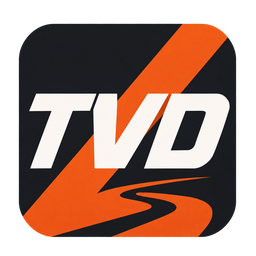

# TVD Rally Launcher

  

**Лаунчер сообщества TVD Rally для DiRT Rally 2.0.**

Чемпионаты TVD прямо в игре, результаты спецучастков, команды, общение и приборы для заездов — в одном приложении.

[Скачать лаунчер](https://tvdrally.online/launcher) · [Сайт TVD Rally](https://tvdrally.online/) · [Вопросы о лаунчере](FAQ.md) · [Установка](#установка-и-первый-запуск)

## Скачать актуальную версию

**Публичная версия: 3.2.69.**

- [Скачать установщик TVD Rally 3.2.69 (.exe)](https://github.com/L3xi4/tvd-launcher-dr-2.0/releases/download/v3.2.69/TVD-Rally-Setup-3.2.69.exe).
- [Скачать архив TVD Rally 3.2.69 для Windows](https://github.com/L3xi4/tvd-launcher-dr-2.0/releases/download/v3.2.69/TVD-Rally-3.2.69.zip).
- [Последний выпуск на GitHub](https://github.com/L3xi4/tvd-launcher-dr-2.0/releases/latest) — изменения и файлы для скачивания.
- [Установщик с ярлыками и инструкция на сайте](https://tvdrally.online/launcher).

Архив нужно полностью распаковать, затем открыть папку **TVD Rally** и запустить **TVD Rally.exe**. Для установки с ярлыками скачайте **TVD-Rally-Setup-3.2.69.exe** из выпуска GitHub — он сразу устанавливает версию **3.2.69**.

## Возможности лаунчера

### Чемпионаты, календарь и роудбук

- Просмотр доступных чемпионатов, этапов и сроков их проведения.
- Запись на чемпионаты и отображение состояния заявки там, где запись предусмотрена организаторами.
- Регламент на странице соответствующего чемпионата.
- Доступные клубы TVD в разделе **«Клубы»** DiRT Rally 2.0.
- Календарь этапов: текущие, предстоящие и завершённые заезды.
- Роудбук со спецучастками, локациями, условиями и сервисными зонами.
- Состояние текущего этапа, следующий СУ и время до закрытия.

### Результаты и личная история

- Автоматическая отправка результатов спецучастков на сайт TVD.
- Таблицы результатов СУ и этапов, общий зачёт чемпионата.
- Личные и командные зачёты, результаты кубков.
- Время, места, отставания и статусы финиша или схода.
- Цветовое выделение сокомандников в результатах выбранного чемпионата.
- История собственных заездов с результатами спецучастков.
- Сравнение с личным лучшим временем на трассе в том же классе автомобиля.
- Итог спецучастка после финиша.

### Команды и пилоты

- Создание команды и управление ею в соответствии с регламентом проекта.
- Название, логотип, цвет, описание и карточка команды.
- Состав, капитан и контракты участников.
- Командные результаты и участие в кубках.
- Список пилотов, поиск и отображение присутствия в лаунчере.

### Сообщения и общение

- Личные сообщения между пилотами.
- Командные чаты и общий чат TVD.
- Упоминания через **@ник** и кнопку «Упомянуть».
- Настройки каждого чата: все уведомления, только упоминания или без уведомлений.
- Звук уведомлений по желанию; настройки сохраняются в аккаунте.
- **Enter** отправляет сообщение, **Shift + Enter** добавляет новую строку.

### Дашборд и телеметрия

- Настраиваемые панели поверх игры: скорость, передача, обороты и информация о заезде.
- Индикация газа, тормоза, сцепления и ручника.
- Панели руля, перегрузок, колёс и карта спецучастка.
- Отставание, итог СУ и информационная строка этапа.
- Перемещение панелей и выбор нужных элементов.
- Настройка чтения оси ручника с совместимого устройства.
- Настройки подключения к телеметрии игры для совместной работы с другими программами.

Набор показаний зависит от поступающей телеметрии и подключённых устройств.

### Трансляции и OBS

- Панели для OBS в виде страниц с прозрачным фоном.
- Отдельные элементы или общий набор, повторяющий настроенный дашборд.
- Приборы, педали, руль, карта СУ и информация об этапе для трансляции.
- Возможность использовать панели OBS без дашборда на игровом экране.

### Телефон как второй экран

- Подключение телефона по QR-коду в одной домашней сети с ПК.
- Скорость, передача и обороты во время заезда.
- Название машины и её класс.
- Информация об этапе, собственных спецучастках и таблица результатов между СУ.
- Обновление ссылки подключения из настроек лаунчера.

### Виртуальная реальность

- Выбор запуска игры в обычном режиме, через SteamVR или Oculus.
- Отдельная панель для SteamVR: время СУ, отставание, передача и педали.

Для VR нужны совместимый шлем и настроенное программное обеспечение. Панель SteamVR требует запуска через SteamVR.

### Уведомления и работа в фоне

- Уведомление о записанном результате СУ и звуковой сигнал по желанию.
- Напоминание о скором закрытии недоеханного этапа.
- Уведомления о сообщениях и ответах поддержки.
- Работа в системном трее и настройки поведения при закрытии окна.

### Интерфейс и быстрые действия

- Варианты главного экрана: **«Роудбук»**, **«Фокус»** и **«Панель»**.
- Классический интерфейс и переключение на новый вид.
- Выбор акцентного цвета, фона и фоновой анимации.
- **«Штурман» — Ctrl + K:** быстрый поиск разделов, действий, этапов и пилотов.
- Навигация с совместимого геймпада или руля со стандартной раскладкой кнопок.

### Обзоры этапов и поддержка

- Раздел с опубликованными обзорами этапов.
- Встроенная помощь и база знаний с поиском по вопросам о лаунчере.
- Создание обращения с выбором раздела, темы и описанием проблемы.
- **«Мои обращения»**: номер, статус, ответы организаторов и переписка по тикету.
- Поиск и фильтры обращений, продолжение переписки и повторное открытие закрытого тикета.

### Установка, запуск и обновления

- Вход с аккаунтом сайта TVD Rally.
- Автоматическая настройка игрового подключения и запуск DiRT Rally 2.0 через Steam.
- Проверка новых версий, обновление из лаунчера и описание изменений для пилотов.

Доступность чемпионатов, материалов и отдельных возможностей зависит от текущей версии, настроек проекта и условий конкретного чемпионата.

## Что понадобится

- ПК с **Windows 10 или Windows 11**.
- Установленная **DiRT Rally 2.0 в Steam**.
- Интернет и аккаунт на [tvdrally.online](https://tvdrally.online/).

Проект развивается; лаунчер находится в бета-тестировании.

## Установка и первый запуск

1. Скачайте актуальный установщик со [страницы лаунчера](https://tvdrally.online/launcher).
2. Запустите установщик и следуйте подсказкам.
3. Откройте **TVD Rally** через ярлык **TVD Rally Launcher** на рабочем столе или в меню «Пуск».
4. Войдите с логином и паролем от сайта TVD Rally. Если аккаунта ещё нет, [зарегистрируйтесь](https://tvdrally.online/register).
5. Нажмите **«Поехали»** и подтвердите запрос Windows на права администратора, если он появится.
6. После запуска игры откройте **«Клубы»**, выберите доступный чемпионат TVD и начните заезд.

Полная инструкция и условия участия доступны на [странице скачивания](https://tvdrally.online/launcher). Регламент конкретного чемпионата можно прочитать в лаунчере на его странице.

## Если нужна помощь

Начните с [вопросов и ответов о лаунчере](FAQ.md) или откройте **«Помощь и поддержка»** внутри приложения: там есть база знаний и форма обращения к организаторам.

Если готового ответа нет, создайте тикет. Укажите версию лаунчера, что делали перед ошибкой и её текст; по возможности приложите скриншот. Следить за ответом и продолжать переписку можно в **«Моих обращениях»**.

## Обновления

Актуальная версия доступна на [официальной странице скачивания](https://tvdrally.online/launcher). Изменения для пилотов отображаются в лаунчере при обновлении.

## О проекте

TVD Rally — проект сообщества любителей ралли. Это независимый проект, не являющийся официальным продуктом Codemasters или Electronic Arts. Названия игр и торговые марки принадлежат их владельцам.

Этот репозиторий содержит публичное описание лаунчера и инструкции для участников.
